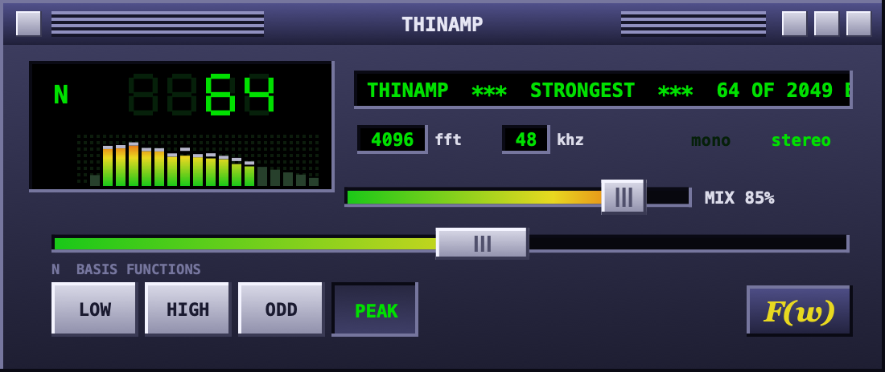

# Thinamp

A spectral thinning effect with a Winamp 2.x face: turn one knob and the sound is rebuilt from fewer and fewer of
its Fourier basis functions.

Under the hood: STFT (4096-point, 75% overlap), keep N of the 2049 Fourier basis functions per frame, resynthesise.
Two knobs (N, dry/wet) plus four modes: LOW, HIGH, ODD (sparse odd bins), PEAK (strongest N).

## Install (Mac)

Open Terminal (Cmd+Space, type "Terminal"), paste this and press Enter:

    curl -fsSL https://raw.githubusercontent.com/mostlyworking/thinamp/main/install.sh | bash

Then restart your DAW or rescan plugins (see below). It installs both formats: VST3 and Audio Unit (AU).

Without Terminal: download `Thinamp-mac.zip` from
[Releases](https://github.com/mostlyworking/thinamp/releases/latest), unzip it, right-click
"Install Thinamp.command" and choose Open (the plugin isn't notarized by Apple, so a plain double-click is blocked).

## Finding it in your DAW

| DAW | Format | Steps |
|---|---|---|
| Ableton Live | VST3 or AU | Settings > Plug-Ins: turn on "Use VST3 Plug-In System Folders", click Rescan |
| Logic Pro, GarageBand | AU | Restart the app. In Logic, if it's missing: Logic Pro > Settings > Plug-in Manager > Reset & Rescan Selection |
| FL Studio | VST3 | Options > Manage plugins > Find installed plugins |
| Bitwig Studio | VST3 | Restart; plugins in the standard folders are scanned on startup |
| Reaper | VST3 or AU | REAPER > Settings > Plug-ins > VST > Re-scan |
| Cubase, Nuendo | VST3 | Restart, or Studio > VST Plug-in Manager to check it's listed |
| Studio One | VST3 or AU | Restart; new plugins are scanned on startup |

It shows up as "Thinamp" by "Dan Vicente", usually under audio effects or the filter category.
If a newly installed AU doesn't appear, log out of macOS and back in once.

## Behaviour

- Hann-windowed 4096-point STFT, hop 1024; keeping all bins reconstructs the input exactly.
- Latency 4096 samples, reported to the host; dry is delayed to match, so mixing is phase-aligned.
- N: 1..2048, log knob, default 2048. Glides per frame; a fractional N keeps one boundary bin at partial weight.
- LOW keeps bins 0..N-1, HIGH the top N, ODD the lowest N odd bins (max 1024), PEAK the N loudest per frame and channel.
- Mix 0 is exactly the delayed input. Output does not depend on host block size. Checked by `EngineTests`.

## Build

Release zip for GitHub: `./scripts/package.sh` (universal arm64 + x86_64, output in `dist/`).

    brew install cmake ninja
    cmake -S . -B build -G Ninja -DCMAKE_BUILD_TYPE=Release
    cmake --build build              # copies the VST3 and AU into ~/Library/Audio/Plug-Ins
    ./build/EngineTests_artefacts/Release/EngineTests
    ./build/UiSnapshot_artefacts/Release/UiSnapshot ui.png 3 64   # offscreen UI render: mode 0-3, N

## Ableton

Settings > Plug-Ins: enable "Use VST3 Plug-In System Folders", then Rescan. Latency (4096 samples, ~93 ms at
44.1 kHz) is reported, so Live's delay compensation keeps it in time.
